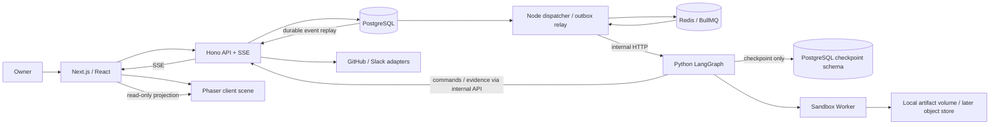

# 시스템 아키텍처

## Phase 1 구현 보충 — 2026-10-19

현재 로컬 구독 실행은 [ADR-011](17-decision-log.md)의 PostgreSQL 영구 큐→Node WorkflowRunner→공식 Codex CLI PM/Developer/QA→Docker broker 경로다. 아래 Redis/BullMQ·Python LangGraph HTTP 그림은 최초 확장 설계이며 현재 실행 구성과 구분한다. 추가 API 공급자 과금 경로는 구현하지 않는다. DB 상태/lease/승인 권한, 역할별 증거와 Sandbox 책임은 유지한다. 범용 저장소 실행은 미지원이다.

## 1. 목적

실행 엔진의 정확성과 격리를 확보하면서 1인 개발에 맞는 최소 프로세스 경계를 정한다.

## 2. 범위

Next.js 웹, Hono API/SSE, Node dispatcher, Python LangGraph 엔진, Sandbox Worker, PostgreSQL, Redis로 구성한다. dispatcher는 별도 제품/서비스가 아니라 API 코드베이스의 worker 실행 모드다. Sandbox는 별도 실행 경계를 유지한다.

## 3. 요구사항

큐 유실/재전달, 프로세스 중단, 승인 대기, SSE 재접속을 견딘다. 외부 통합 장애가 로컬 개발 결과를 지우지 않는다. B단계부터 모든 업무 데이터에 organizationId·projectId를 둔다.

## 4. 설계 내용

| 경계 | 책임 | 책임 밖 |
|---|---|---|
| Web/Phaser | 명령 입력·상태 표현·승인 UI | 임의 완료·예산/권한 결정 |
| Hono | 인증·도메인 전이·예산·승인·이벤트·SSE | LLM reasoning·임의 셸 |
| Node dispatcher | outbox→BullMQ, job claim, engine 명령 전달·reconcile | 작업 성공 판정 |
| LangGraph | PM/Dev/QA 흐름·체크포인트·제한 재작업 | DB 임의 변경·host 셸 |
| Sandbox | 허용된 파일/Git/test/build, 자원·네트워크 통제 | LLM 키·운영 자격 증명 보유 |
| 통합 adapter | 승인된 GitHub/Slack 작업·재시도 | 자체 권한 상승 |

브라우저와 API는 동일 origin의 `/api` reverse proxy로 연결한다. 인증 쿠키·CSRF·SSE 처리가 한 경로를 사용한다. 서버 간 HTTP는 내부 네트워크와 서비스 인증을 사용한다.

## 5. 기술적 근거

BullMQ와 Python의 책임/언어 경계를 명시하기 위해 Node worker→HTTP→Python 방식을 선택했다. Python BullMQ 패키지가 있다는 사실과 조합의 운영 검증은 다르다. 대안과 검증 상태는 [03](03-technology-decisions.md), [ADR-002](17-decision-log.md)에 있다.

## 6. 데이터 흐름

1. API가 원문 task와 RUN 요청 의도를 트랜잭션으로 저장한다.
2. dispatcher가 outbox를 BullMQ에 전달한다. job은 최소 식별자만 포함한다.
3. worker가 API에서 lease/fencing token을 획득하고 Python에 실행 slice를 요청한다.
4. Python은 durable checkpoint와 tool operation ledger를 참조해 노드를 실행한다.
5. 내부 API가 토큰·version을 확인한 뒤 도메인 상태/이벤트를 기록한다.
6. 승인/장기 대기는 checkpoint 저장 후 worker slot을 해제한다. 이후 resume job이 이어간다.
7. API/SSE는 DB 이벤트를 읽고 웹은 projection을 갱신한다.

## 7. 예외 처리

Node↔Python HTTP 응답이 사라지면 요청을 무조건 새 실행으로 만들지 않는다. operationId로 상태를 조회한다. queue 완료는 slice 인계 성공이며 task 완료가 아니다. lease 만료 시 새 token을 발급하고 이전 token의 쓰기를 거부한다. 격리 실행 종료/원격 부작용 확인이 안 되면 자동 재실행 대신 차단한다.

## 8. 보안 고려사항

Engine은 앱 도메인 DB에 직접 쓰지 않는다. 전용 checkpoint schema에만 접근하고 나머지는 내부 API로 처리한다. Sandbox는 host 저장소·Docker socket·서비스 비밀을 공유하지 않는다. 표준 프로필의 제한을 실제 부정 테스트로 검증한다.

## 9. 구현 우선순위

Phase 0은 Web/API/DB/SSE에 집중한다. Phase 1에 Redis/dispatcher/Engine/Sandbox를 연결한다. GitHub/Slack adapter는 Phase 3에서 같은 operation 계약에 추가한다.

## 10. 완료 기준

사용자 task부터 결과 근거까지 식별자 추적, DB commit 후 큐 전송 실패 복구, 중복 job·stale worker 쓰기 거부, 승인 대기 중 프로세스 재시작, SSE 복원 시험을 통과한다.

## 11. 미확정 사항

HTTP slice timeout·worker 동시 수·Sandbox 런타임과 자원 한도는 부하/안전 시험으로 고정한다. 초기 후보 설정은 [15](15-deployment-and-operations.md)에 있으며 성능 보장값이 아니다.
