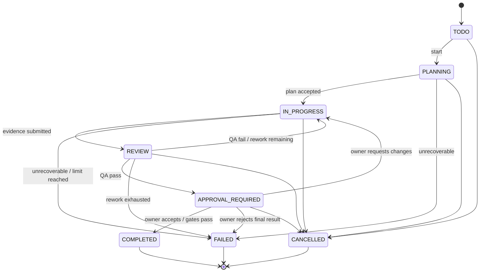
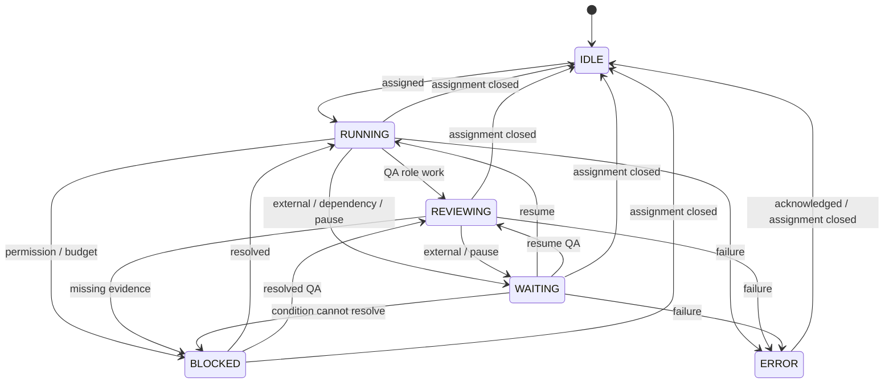
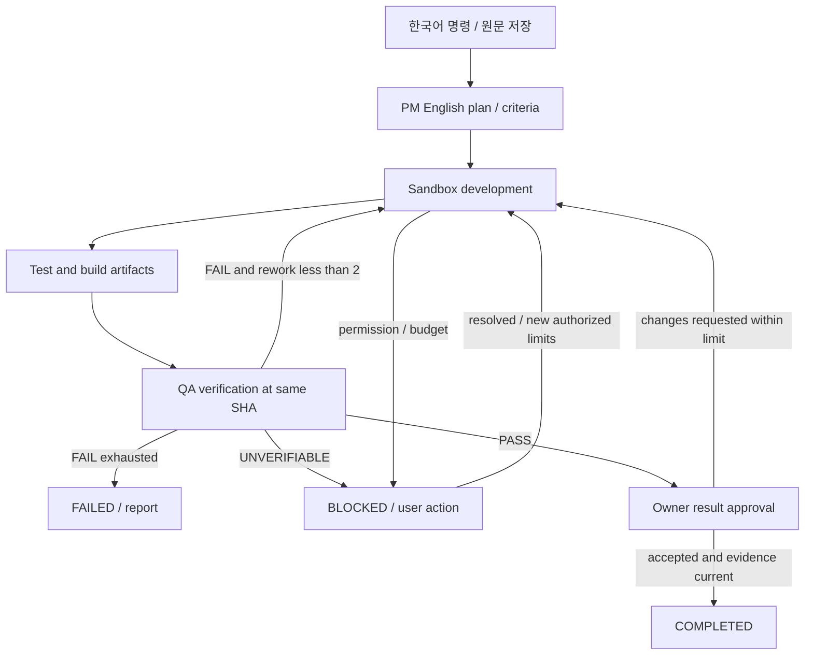

# 실행 워크플로와 상태 머신

## 1. 목적

업무·직원·실행·승인을 분리하고 완료·재작업·중단·복구의 단일 계약을 제공한다.

## 2. 범위

업무 상태는 원문 코드 8개를 유지한다. 일시 중지는 task의 새 상태가 아니라 workflow run의 제어 상태다. `blockedReason`은 상태를 대체하지 않는 사유 필드다.

## 3. 요구사항

| Task 코드 | 한국어 | Agent 코드 | 한국어 |
|---|---|---|---|
| TODO | 할 일 | IDLE | 대기 중 |
| PLANNING | 계획 중 | RUNNING | 작업 중 |
| IN_PROGRESS | 진행 중 | WAITING | 응답 대기 |
| REVIEW | 검토 중 | REVIEWING | 검토 중 |
| APPROVAL_REQUIRED | 승인 대기 | BLOCKED | 진행 불가 |
| COMPLETED | 완료 | ERROR | 오류 발생 |
| FAILED | 실패 |  |  |
| CANCELLED | 취소 |  |  |

IDLE은 활성 assignment가 없고 WAITING은 외부/선행 조건을 기다리는 실행이 있다. 오류 종료 후 업무 연결을 해제하면 ERROR→IDLE로 전이하며 오류 이력은 보존한다.

## 4. 설계 내용

TODO→PLANNING은 PM 실행 lease 획득과 함께 기록한다. 모든 전이는 API에서 expectedVersion·조직·권한·gate를 검사한다. terminal task의 재시도는 새 workflow run 생성과 명시적인 retry 명령으로 FAILED→PLANNING을 허용하며, 이전 run은 terminal로 보존한다. CANCELLED 재시작은 새 task로 한다.

workflow_runs: QUEUED, RUNNING, PAUSE_REQUESTED, PAUSED, WAITING_APPROVAL, BLOCKED, SUCCEEDED, FAILED, CANCELLED. 허용 전이는 QUEUED→RUNNING, RUNNING→PAUSE_REQUESTED→PAUSED, PAUSED→QUEUED, RUNNING→WAITING_APPROVAL/BLOCKED, WAITING_APPROVAL/BLOCKED→QUEUED, RUNNING→SUCCEEDED/FAILED/CANCELLED다. QUEUED/PAUSE_REQUESTED/PAUSED/WAITING_APPROVAL/BLOCKED에서도 CANCELLED로 종료할 수 있다. FAILED의 retry는 새 run으로 수행한다. agent_runs는 개별 역할 attempt이며 QUEUED/RUNNING/WAITING/SUCCEEDED/FAILED/CANCELLED를 사용한다. 역할 run의 SUCCEEDED와 task의 COMPLETED는 다르다.

## 5. 기술적 근거

LangGraph interrupt는 영구 checkpoint와 동일 thread_id를 이용한 재개에 사용한다. 재개 시 노드가 다시 실행될 수 있으므로 외부 부작용은 operation ledger와 멱등 계약을 따른다. [공식 Interrupts](https://docs.langchain.com/oss/python/langgraph/interrupts)를 2026-10-18 확인했다. 프레임워크만으로 업무상 exactly-once를 보장하지 않는다.

## 6. 데이터 흐름

완료 gate: 필수 AC 전부 PASS, changedFiles/diff 또는 명시된 분석 결과, 같은 candidate SHA의 테스트/빌드 성공, QA PASS, 결과 수락 승인 유효. build가 정의되지 않은 작업은 계획 단계에 검증 방법을 합의한다. 실행 불가를 사후 N/A로 바꾸지 않는다. 분석 전용 task는 코드 변경 대신 분석 Artifact를 필수로 명시한다.

PR은 Phase 3에서 QA PASS 이후 생성할 수 있다. 결과 수락·PR 생성·merge·배포 승인은 서로 다른 action이다. 로컬 결과 수락이 merge나 배포를 허가하지 않는다.

## 7. 예외 처리

재작업 2회는 최초 개발 이후 최대 2번의 수정 cycle, 즉 최대 3개 candidate다. QA 실패와 Owner 변경 요청이 모두 같은 reworkCount를 소비한다. 초과 시 FAILED로 종료하고 새 범위/예산의 retry 승인을 받는다. 전송 오류 재시도는 별도 정책으로 동일 operationId를 유지한다.

pause는 안전한 node/tool 경계에서 checkpoint 후 PAUSED가 된다. 즉시 중단이 필요하면 Sandbox process group을 종료하고 미확정 부작용을 reconcile한다. cancel은 lease를 폐기하고 후속 쓰기를 거부하며 결과를 보존한다. 승인 대기 중에는 큐 worker를 점유하지 않는다.

## 8. 보안 고려사항

승인은 PENDING→APPROVED/REJECTED/EXPIRED, APPROVED→CONSUMED/EXPIRED다. 변경 SHA/권한/정책/범위가 달라지면 stale 처리하고 새 승인을 만든다. 고위험 행위 전에 동적 검사를 통과해야 한다. 결과 수락을 위한 대기와 중간 tool 승인 대기는 approval purpose로 구분한다. 중간 tool 승인은 task의 현재 개발/검토 상태를 유지하고 run만 WAITING_APPROVAL로 둔다.

## 9. 구현 우선순위

Phase 0 task 전이/이벤트, Phase 1 run·checkpoint·승인·제한 재작업, Phase 3 원격 PR/CI와 부작용 조정을 구현한다.

## 10. 완료 기준

불법 전이·동시 승인·stale SHA·재작업 초과·미실행 테스트·취소 후 쓰기·재시작 후 중복 부작용을 모두 시험한다. 세부 테스트는 [14](14-testing-strategy.md)에 있다.

## 11. 미확정 사항

pause 응답 SLA·노드 timeout·승인 만료 기본값은 Phase 0/1 실험으로 고정한다. 자동 승인·자동 merge는 도입하지 않는다.
