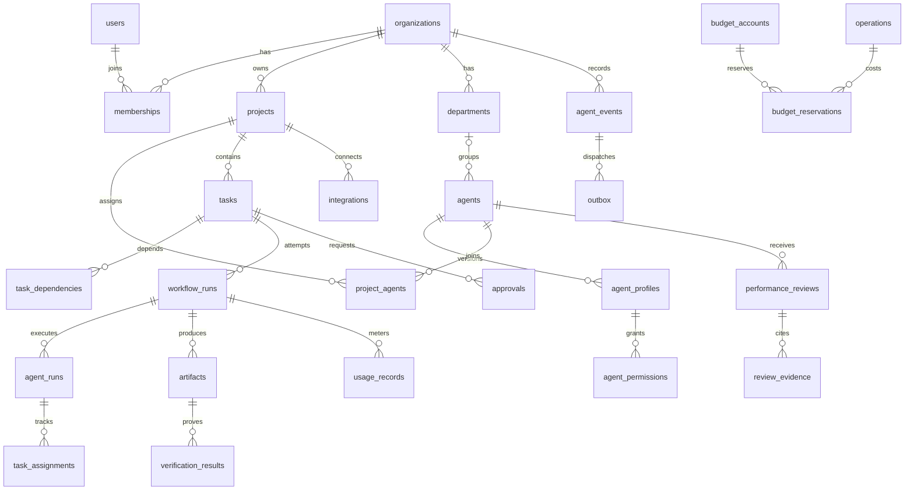

# 데이터베이스 설계

## 1. 목적

영구 상태·실행 근거·승인·비용·조직 확장을 같은 식별자로 연결한다. 이 문서는 논리 스키마이며 migration이나 서비스 코드가 아니다.

## 2. 범위

PostgreSQL 도메인 schema와 LangGraph 전용 checkpoint schema를 분리한다. B단계는 일부 테이블만 활성화하지만 organizationId·projectId 경계는 처음부터 둔다.

## 3. 요구사항

기본 타입: ID는 UUID, 시각은 timestamptz(UTC), 토큰/sequence는 bigint, 금액은 numeric(20,10), 상태/역할은 text+CHECK, 구조화 확장 필드는 jsonb. UI JSON의 bigint는 문자열이다. 금액은 currency와 함께 저장한다. 금액·토큰·시간·retryCount는 음수를 금지한다.

공통 약어: `id`는 UUID PK, `org`는 organization_id FK, `project`는 project_id FK, `created/updated`는 timestamptz, `version`은 int 기본 1이다. 별도 설명이 없으면 필수 컬럼은 NOT NULL, `?`만 nullable이다. tenant 테이블은 `(org,id)` UNIQUE를 두고 자식은 `(org,parent_id)` 복합 FK로 타 조직 참조를 차단한다. 프로젝트 소속 관계는 `(org,project,id)`와 복합 FK까지 검증한다.

## 4. 설계 내용

### 핵심 엔터티

| 테이블 | 주요 컬럼과 타입 | 제약·인덱스 / 도입 |
|---|---|---|
| organizations | id, name text, status text, created | status ACTIVE/SUSPENDED; Phase 0 |
| users | id, external_subject text, display_name text, created | external_subject UNIQUE; Phase 0 |
| memberships | id, org, user_id UUID FK, role text, status text | UNIQUE(org,user_id); Owner/Viewer, B는 Owner만; Phase 0 |
| sessions | id, user_id FK, token_hash text, expires_at timestamptz, revoked_at? | token_hash UNIQUE; expiry index; Phase 0 |
| departments | id, org, name text, archived_at?, version | UNIQUE(org,name) 활성 이름; Phase 3 |
| projects | id, org, name text, repository_url text, default_branch text, status text, version, created/updated | org/status index; 저장소 URL 정책 검사; Phase 0 |
| project_memberships | id, org, project, user_id FK, role text | UNIQUE(org,project,user_id); Phase 4, B는 조직 Owner 접근 |
| agents | id, org, name text, role text, department_id? FK, employment_status text, runtime_status text, hired_at timestamptz, retired_at?, version | org/status, role index; Phase 1 고정 프로필, Phase 3 채용 |
| agent_profiles | id, org, agent_id FK, profile_version int, provider text, model text, role_prompt text, skills jsonb, work_style jsonb, avatar_ref text, cost_limit numeric, currency text, created | UNIQUE(org,agent_id,profile_version); immutable; Phase 1 |
| agent_permissions | id, org, profile_id FK, tool text, action text, scope jsonb, risk_level text | UNIQUE(org,profile_id,tool,action); 실행 시 정책 교집합; Phase 1 |
| project_agents | id, org, project, agent_id FK, active bool | UNIQUE(org,project,agent_id); tenant/project FK; Phase 1 |
| tasks | id, org, project, title text, command_original_ko text, command_hash text, source text, spec_en? text, spec_version int, acceptance_criteria jsonb, priority text, status text, blocked_reason? text, version, created_by FK, created/updated | 8개 task 상태 CHECK; org/project/status/created index; Phase 0 |
| task_dependencies | org, project, task_id FK, depends_on_task_id FK | 복합 PK(org,task_id,depends_on_task_id), self edge 금지, DAG 검사; Phase 4 |
| workflow_runs | id, org, project, task_id FK, attempt int, status text, control_version int, rework_count int, checkpoint_thread_id text, candidate_sha? text, policy_snapshot jsonb, lease_token bigint, lease_expires_at?, heartbeat_at?, created/updated | UNIQUE(org,task_id,attempt), 활성 run은 task당 1개 partial UNIQUE; Phase 1 |
| agent_runs | id, org, project, workflow_run_id FK, task_id FK, agent_id FK, profile_id FK, role text, attempt int, status text, started_at?, finished_at?, failure_code? text | workflow/role/attempt UNIQUE, agent/status index; Phase 1 |
| task_assignments | id, org, project, task_id FK, agent_id FK, agent_run_id FK, role text, status text, created/closed_at? | 직원당 활성 assignment 1개 partial UNIQUE(B), task 다중 역할 허용; Phase 1 |
| agent_events | id(eventId), org, project? FK, workflow_run_id? FK, task_id? FK, agent_id? FK, sequence bigint, schema_version int, type text, aggregate_version int, payload jsonb, occurred_at timestamptz, source_event_id? text | UNIQUE(org,sequence), UNIQUE(org,source_event_id) nullable, org/project/sequence index; Phase 0 |
| organization_event_counters | org PK/FK, last_sequence bigint | 이벤트 transaction의 첫 row lock; Phase 0 |
| artifacts | id, org, project, task_id FK, workflow_run_id FK, agent_run_id? FK, kind text, storage_ref text, content_hash text, size_bytes bigint, candidate_sha? text, metadata jsonb, created | task/run/kind index, storage_ref는 서버 발급; Phase 1 |
| verification_results | id, org, project, task_id FK, workflow_run_id FK, criterion_id text, kind text, status text, candidate_sha text, artifact_id FK, command_spec jsonb, exit_code? int, started_at/finished_at timestamptz, verified_by FK(agent) | PASS/FAIL/UNVERIFIABLE/NOT_RUN, run/SHA/criterion index; Phase 1 |
| approvals | id, org, project, task_id FK, workflow_run_id? FK, purpose text, action text, scope jsonb, scope_hash text, candidate_sha? text, policy_version int, status text, requested_by_agent? FK, decided_by_user? FK, decision_metadata? jsonb, expires_at timestamptz, decided_at?, consumed_at?, version | PENDING/APPROVED/REJECTED/EXPIRED/CONSUMED; status/expiry index; Phase 1 |
| usage_records | id, org, project, task_id FK, workflow_run_id FK, agent_run_id FK, agent_id FK, provider text, model text, provider_request_id? text, input_tokens? bigint, output_tokens? bigint, cached_input_tokens? bigint, estimated_cost numeric, actual_cost? numeric, currency text, price_version text, execution_ms bigint, retry_count int, task_success? bool, communication_language text, usage_status text, created | 알려진 경우 cached<=input; 미확인 토큰은 null; provider request UNIQUE 가능 범위; agent/task/time index; Phase 1 |
| performance_reviews | id, org, project, task_id FK, reviewer_agent_id? FK, reviewer_user_id? FK, subject_agent_id FK, type text, rubric_version int, scores jsonb, weights jsonb, score? numeric, body_en text, original_ko? text, summary_ko text, status text, created | type별 reviewer shape CHECK; subject/task/type/reviewer UNIQUE; PUBLISHED만 score 필수; Phase 4 |
| review_evidence | org, review_id FK, artifact_id? FK, verification_id? FK, external_ref? text, evidence_hash text, claim text | 증거 target 정확히 하나, FK 삭제 RESTRICT; Phase 4 |
| integrations | id, org, project? FK, provider text, installation_ref text, secret_ref text, granted_scopes jsonb, status text, config jsonb, version | provider/installation UNIQUE(org 범위), 비밀 값 저장 금지; Phase 3 |
| audit_logs | id, org, project? FK, actor_type text, actor_id text, action text, target_type/id text, request_id text, outcome text, before_hash? text, after_hash? text, metadata jsonb, created | org/time, actor/time, target index; append-only 앱 역할; Phase 0 최소 |

### 전달·비용·부작용 지원 엔터티

| 테이블 | 주요 컬럼 | 제약·용도 |
|---|---|---|
| outbox | id, org, event_id? FK, destination text, operation_id UUID, payload jsonb, status text, attempt int, next_attempt_at timestamptz, delivered_at? | UNIQUE(org,destination,operation_id); status/time index; Phase 1 |
| inbox_receipts | id, org, provider text, source_event_id text, payload_hash text, received_at, processed_at?, status text | UNIQUE(org,provider,source_event_id); Phase 1 내부, Phase 3 외부 |
| operations | id(operationId), org, project, workflow_run_id? FK, approval_id? FK, kind text, scope_hash text, request_hash text, status text, lease_token bigint, remote_ref? text, result_artifact_id? FK, created/updated | UNIQUE(org,kind,scope_hash) 의도적 반복은 새 scope에 attempt 포함; PENDING/RUNNING/SUCCEEDED/FAILED/UNKNOWN |
| idempotency_keys | org, actor_id text, route text, key text, request_hash text, response_ref jsonb, expires_at | 복합 PK(org,actor_id,route,key); 동일 key 다른 body 409 |
| budget_accounts | id, org, project? FK, agent_id? FK, period_start/end timestamptz, limit_amount numeric, reserved_amount numeric, spent_amount numeric, currency text, version | 범위/기간별 UNIQUE, 음수 금지, row lock으로 동시 예약 |
| budget_reservations | id, org, operation_id FK, account_id FK, amount numeric, settled_amount? numeric, status text, expires_at?, created | UNIQUE(org,operation_id,account_id); HELD/SETTLED/RELEASED/UNKNOWN |
| price_versions | id, provider text, model text, currency text, input_per_million/output_per_million/cached_per_million numeric, valid_from timestamptz, source_url text, checked_at timestamptz | 가격 불변 snapshot; 최신 가격 자동 추정 금지 |
| agent_employment_events | id, org, agent_id FK, type text, effective_at timestamptz, actor_user_id FK, reason text | 채용/휴직/퇴사/재채용 이력; Phase 3~4 |

외부 SDK가 소유하는 checkpoint 테이블은 전용 schema와 계정으로 관리하며 앱 migration에서 임의 변경하지 않는다. thread_id는 workflow_run id를 기반으로 고정하고 tenant 경로와 함께 검증한다.

### 관계

## 5. 기술적 근거

[PostgreSQL Explicit Locking](https://www.postgresql.org/docs/current/explicit-locking.html), 2026-10-18 확인. row lock과 transaction을 사용하되 외부 API 요청까지 긴 transaction을 유지하지 않는다. Drizzle는 앱 도메인 migration을 관리한다. 계약·제약은 SQL로 구현 시 검증한다.

## 6. 데이터 흐름

명령 transaction에서 task/version/event/outbox를 함께 저장한다. 승인 소비와 operation 생성은 원자적으로 처리하고 외부 호출은 commit 뒤에 한다. 원격 결과 UNKNOWN이면 기존 operation과 승인 소비 상태를 보존한 채 reconcile하며 같은 승인으로 다른 operation을 생성하지 않는다.

## 7. 예외 처리

동시 task 수정은 expectedVersion 조건 실패 시 409다. 이벤트를 기록할 transaction은 조직 counter lock을 가장 먼저 얻고, 이후 프로젝트/DAG lock이나 org→project→agent 예산 lock 등 도메인별 고정 순서를 적용한다. DAG edge 삽입은 프로젝트 row lock 후 재귀 경로 검사로 cycle을 막는다. deadlock/serialization 오류는 같은 idempotency key로 제한 재시도한다. lease token이 오래된 결과는 event로 받아들이지 않는다.

평가 중복 제약은 nullable reviewer에 단일 UNIQUE만 적용하지 않는다. AUTO는 `(org,task,subject,type)`, USER는 여기에 reviewer_user_id, PEER/SELF/PM은 reviewer_agent_id를 포함한 유형별 partial UNIQUE로 집행한다. PostgreSQL 기본 NULL 비교 특성 때문에 system 평가가 중복되는 것을 막는다.

## 8. 보안 고려사항

조직/프로젝트 복합 FK와 API scope 검사를 함께 사용한다. RLS는 방어층 후보이며 connection pool의 session scope 누출 시험 전 구현 완료로 표시하지 않는다. 비밀은 secret_ref만 보관한다. 앱은 감사 로그 UPDATE/DELETE 권한이 없다. DB 관리자 변조까지 방지하는 불변 저장소라고 주장하지 않는다.

## 9. 구현 우선순위

Phase 0: organizations/users/memberships/sessions/projects/tasks/events/counters/audit. Phase 1: 실행/직원/증거/승인/전달/비용. Phase 3: 부서/채용/통합. Phase 4: 평가/다중 프로젝트/의존성 확장.

## 10. 완료 기준

모든 FK·CHECK·UNIQUE·partial index를 migration integration test로 확인한다. 타 조직 FK, 동시 활성 run, 중복 승인 소비, cycle, 음수 비용, 이전 lease 쓰기를 실제로 거부해야 한다.

## 11. 미확정 사항

보관 기간은 [15](15-deployment-and-operations.md)의 후보 기준을 검토해 확정한다. 기본은 하드 삭제 대신 archive/soft retirement이며 업무·평가·Artifact 증거 FK는 RESTRICT다. 개인정보 삭제 요청은 보관 의무와 권한을 확인한 별도 익명화/삭제 절차로 처리하며 법적 충족을 단정하지 않는다.
