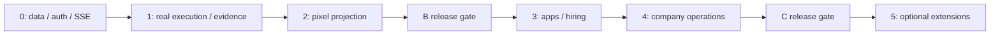

# B → C 개발 로드맵

## 1. 목적

실제 실행 엔진을 먼저 구축하고 같은 데이터·상태·이벤트 계약으로 회사 운영 기능까지 확장한다.

## 2. 범위

B단계는 Phase 0~2, C단계는 Phase 3~4다. Phase 5는 별도 산정하는 후속 기능이다. 이번 문서 작성은 Phase 0 구현 완료에 포함하지 않는다.

## 3. 요구사항

모든 Phase는 선행 gate를 통과해야 하고 테스트 결과 없는 기능을 완료로 표시하지 않는다. 보안·비용·감사 최소 통제는 실제 실행 이전에 구현한다.

## 4. 설계 내용

| Phase | 목표/구현 범위 | 선행 조건 | 완료 증거 | 계획 공수 |
|---|---|---|---|---|
| 0 Foundation | monorepo, 개발 환경, 기본 인증, PostgreSQL, project/task DB, Hono, 이벤트, SSE, 한국어 상태, dashboard | 구현 시작 지시, 런타임/Docker 확인 | 로그인/격리, 프로젝트/업무 생성·조회, 전이 이력, SSE 재접속/reload 복원 | 1주 / 20~30h |
| 1 AI Agent Core | LangGraph PM/Dev/QA, Sandbox, 저장소 분석/수정/test/build, pause/cancel/resume, 승인, usage·상한, 언어 효율 평가 | Phase 0, queue/HTTP/checkpoint·격리 시험, provider 설정 | fixture 저장소 실제 수정·테스트·QA, 최대 재작업, 재시작 복구, 승인/비용 우회 거부 | 2~3주 / 40~90h |
| 2 Pixel Office | Phaser 3/Tiled, 캐릭터·공간·행동, SSE, 말풍선, 상세 패널, 동시 표시·복원 | Phase 1 실제 이벤트·자산 라이선스 | 실제 실행과 scene 일치, replay/reload, UI fallback | 2주 / 40~60h |
| 3 Collaboration & Recruitment | GitHub App/Slack App, Issue/PR/CI, 칸반, 템플릿 채용·프로필·부서·모델·도구·프로젝트 배정 | B 검증, App 설치·scope/채널 권한 | PR/CI 동기화, Slack 보고, 신규 직원 실제 배정, 제한 도구 거부 | 2~3주 / 40~90h |
| 4 Company Operations | 근거 평가·자기/동료/PM/사용자, 성과·인사, 다중 프로젝트·예산·DAG·스케줄, 감사/모니터링 확장·복구 | Phase 3, 평가 데이터, tenant/예산 경합 시험 | 이력 보존·평가 근거·프로젝트 분리·상한·장애 복구 | 3~4주 / 60~120h |
| 5 Advanced | STT/음성 응답, 고급 조직·회의·성과, 자동 모델 선택·비용 최적화, 추가 통합 | 기본 텍스트 시스템 안정, 별도 범위/승인 | 기능별 신규 수용 기준과 개인정보/비용 시험 | 별도 산정 |

원문 일정의 산식: 최소 `1+2+2+2+3=10주`, 최대 `1+3+2+3+4=13주`. 주당 20~30h 가정 시 총 `10×20=200h`부터 `13×30=390h`다. 이는 사용자 제공 초기 계획값이며 실증한 개발 속도나 납기 약속이 아니다. 보안/인증/외부 심사·자산 제작·배포 난이도에 따라 초과할 수 있다.

## 5. 기술적 근거

원문 18~19장의 Phase/공수/가정을 그대로 추적하고, 실제 실행 전에 필요한 최소 감사·비용·권한 통제를 앞당겼다. Phase 4에서는 이를 다중 프로젝트 운영 수준으로 확장한다. PR 목표는 통합 단계인 Phase 3에 둔다.

## 6. 데이터 흐름

각 단계 시작 때 이전 단계의 gate, 미해결 위험, 검증 버전, 남은 예산을 검토한다. 완료 보고는 증거 링크를 포함하고 “대체로 됨”을 gate 통과로 처리하지 않는다.

## 7. 예외 처리

호환성/격리 검증 실패면 Phase 1 실행 범위를 열지 않는다. 통합 설치 지연은 로컬 B 사용과 분리한다. 일정 초과 시 기능을 숨겨 완료 처리하지 않고 범위·추정·선행 조건을 재산정한다. 추가 요구는 변경 관리 절차로 편입한다.

## 8. 보안 고려사항

Phase 0은 로컬 전용이다. 외부 공개/운영 배포에는 인증·secret·격리·backup/restore·승인 통제를 실제 검증하고 Owner 배포 승인을 받는다. Phase 완료가 곧 운영 배포 승인은 아니다.

## 9. 구현 우선순위

Phase 0 첫 순서: 버전/환경 확정 → monorepo/인증 → DB/전이 → API/snapshot → SSE/replay → dashboard → 수직 검증. 상세 작업은 [체크리스트](IMPLEMENTATION_CHECKLIST.md)를 따른다.

## 10. 완료 기준

B 출시: R01~R11/R18 최소 통제를 실제 테스트로 충족한다. C 출시: R12~R18 확장을 충족한다. Phase 5는 초기 출시 gate에서 제외하지만 공통 command 계약을 깨지 않아야 한다.

2026-10-19 구현: Phase 4 P4-01~04 직원 평가·이력·다중 프로젝트/DAG/명시 예약은 제한 Node fixture와 조직 Owner 모델로 검증했다. 운영 경보/장애 복구/backup restore/인계 P4-05~06은 남았으므로 전체 Phase 4/C 출시 완료로 판정하지 않는다. 실제 근거는 README·[체크리스트](IMPLEMENTATION_CHECKLIST.md)·ADR-014를 따른다.

2026-10-20 후속: P4-05 로컬 계측/경보·P4-06-L 암호화 backup/격리 restore·실제 PG/worker 장애·C 판정을 구현해 제한 fixture 기술 gate를 통과했다. 운영 C는 NO_GO이며 off-host/새 호스트·운영 환경/host supervisor 권한 분리·RPO/RTO·기존 상시 ingress/범용 실행/언어 비교·Owner 승인 등은 별도다. 배포·실제 merge는 수행하지 않았다. ADR-015와 최신 README/체크리스트를 따른다.

## 11. 미확정 사항

착수일·개발 시간·외부 App 심사·목표 저장소/부하·실제 provider 예산이 확인되지 않았다. Phase 0 종료 시 구현 속도를 근거로 일정과 비용을 다시 추정한다.
